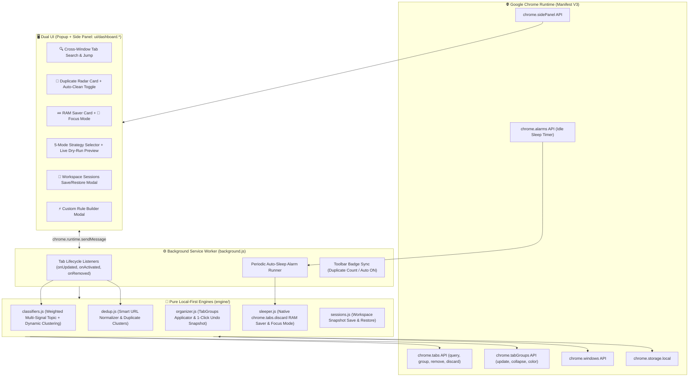
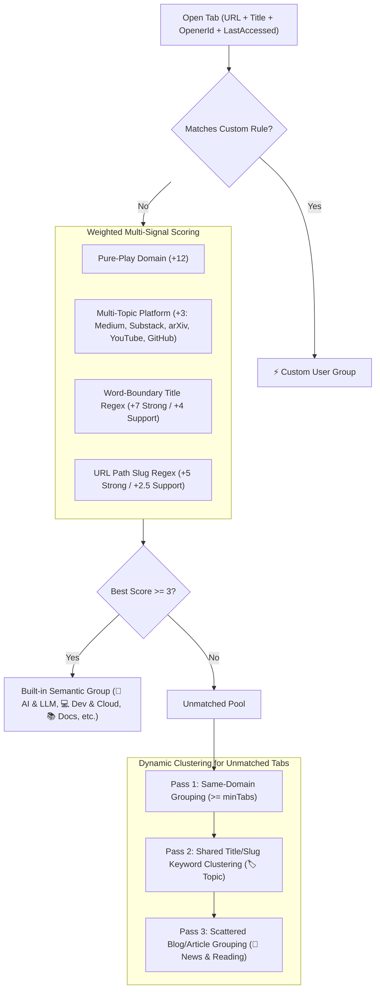

# TabPulse — System Architecture & Technical Specifications

This document details the Manifest V3 architecture, semantic classification pipeline, RAM-saving tab sleeper, duplicate deduplication engine, and workspace session manager powering **TabPulse**.

---

## 🏗️ 1. High-Level System Architecture



---

## 🧠 2. Multi-Signal Semantic Topic Classifier Pipeline (`engine/classifiers.js`)



---

## 💤 3. Smart RAM Saver & Auto-Clean Lifecycle

```mermaid
sequenceDiagram
    participant User
    participant Chrome as Chrome Tabs
    participant SW as background.js
    participant Dedup as engine/dedup.js
    participant Sleeper as engine/sleeper.js

    Note over User,Sleeper: Flow 1: Auto-Clean Duplicate Interception
    User->>Chrome: Opens URL already open in another tab
    Chrome->>SW: tabs.onUpdated(url)
    SW->>Dedup: normalizeUrl(url) [strips UTM, www, #hash]
    Dedup-->>SW: Duplicate match found (existingTabId)
    SW->>Chrome: Focus existingTabId & remove duplicate tab

    Note over User,Sleeper: Flow 2: Smart RAM Saver (Tab Sleeper)
    SW->>Sleeper: chrome.alarms fires (every 5m) OR User clicks "💤 Sleep Idle"
    Sleeper->>Chrome: Query tabs -> skip active, pinned, audible, chrome://
    Sleeper->>Chrome: chrome.tabs.discard(idleTabIds)
    Note right of Chrome: Tab stays in its Tab Group; frees ~95 MB RAM each
    User->>Chrome: Clicks sleeping tab later
    Chrome-->>User: Tab wakes & reloads natively!
```

---

## 🔒 4. Security & Chrome Web Store Compliance Audit

| Checklist Item | Status | Evidence |
| :--- | :---: | :--- |
| **External Network Requests** | 🟢 **PASS (0 Calls)** | Zero `fetch`, `XHR`, `WebSocket`, or analytics beacons anywhere in codebase. |
| **Dynamic Code Execution** | 🟢 **PASS (0 Found)** | Zero `eval()`, `new Function()`, or inline script tags. Strict MV3 CSP compliant. |
| **Data Privacy** | 🟢 **PASS** | 100% local-first (`chrome.storage.local` only). No remote servers. |
| **RAM Safety** | 🟢 **PASS** | Tab Sleeper strictly protects active, pinned, and audio-playing (`tab.audible`) tabs. |
